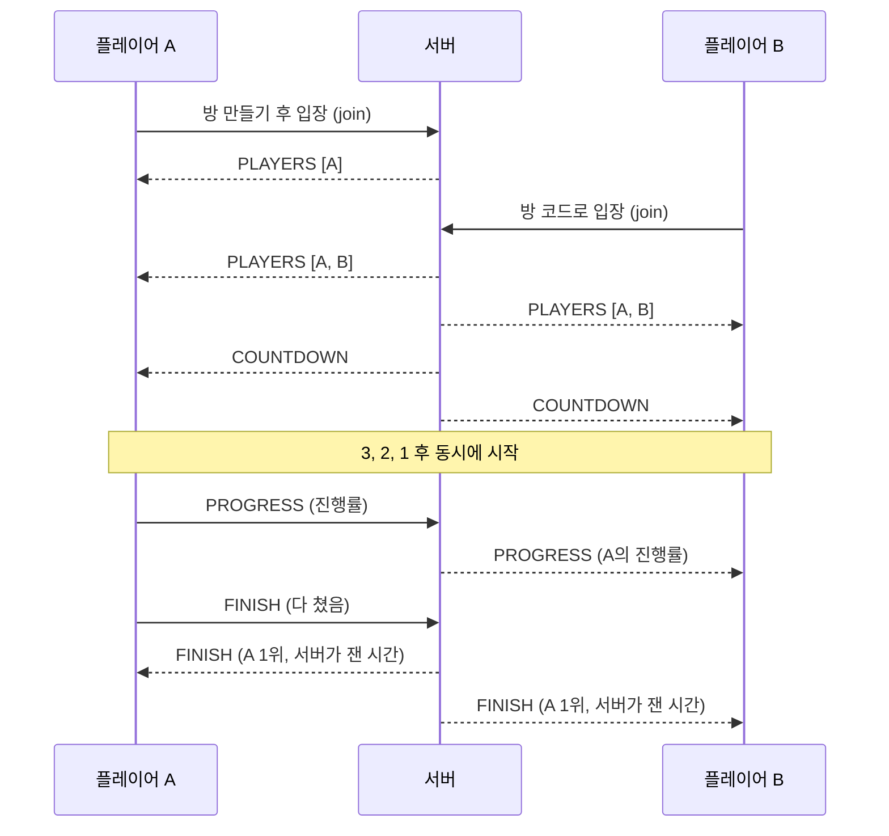

# ⌨️ 코드 타자 배틀

같은 코드를 **누가 먼저 정확하게 치는지** 실시간으로 겨루는 1:1 웹 게임입니다.

**🔗 배포 주소: https://typingbattle-qsov.onrender.com**

> 무료 서버라 한동안 접속이 없으면 잠들어요. 첫 접속은 1~2분 정도 걸릴 수 있습니다.


<br>

## 📌 프로젝트 소개

- **개발 기간:** 2026년 11월 (1일)
- **개발 인원:** 1명
- **만든 이유:** 코드를 빠르고 정확하게 치는 연습을 친구와 게임처럼 하고 싶었습니다. 동시에 실시간 통신(WebSocket)과 Spring 서버 개발을 직접 경험해 보려고 만들었습니다.

<br>

## ✨ 주요 기능

### 1:1 대결
- **방 만들기와 입장:** 방을 만들면 4자리 방 코드가 생기고, 친구는 그 코드로 입장합니다.
- **입장 검사:** 없는 방, 같은 닉네임, 꽉 찬 방(3번째 사람)은 입장을 막고 안내 메시지를 보여 줍니다.
- **동시 시작:** 두 명이 모이면 3초 카운트다운 후 동시에 시작합니다. 시작 전에는 코드를 흐리게 가리고 입력도 막습니다.
- **실시간 진행률:** 상대가 얼마나 쳤는지 진행률 막대가 실시간으로 움직입니다.
- **승패 판정:** 끝까지 먼저 정확하게 친 사람이 1위입니다. 결과 표에 순위, 걸린 시간, 타수, 정확도가 나옵니다.

### 타자 판정
- 맞게 친 글자는 초록색, 오타는 빨간색으로 표시합니다.
- **오타가 나면 백스페이스로 고쳐야** 다음 글자로 넘어갈 수 있습니다.
- 줄 끝에서는 Enter를 쳐야 하고, 줄 앞 들여쓰기는 자동으로 건너뜁니다.
- 한글 입력 상태로 치면 "한/영 키를 눌러 주세요" 경고를 보여 줍니다.

### 그 밖의 기능
- **혼자 연습하기 모드**
- **문제 30개 무작위 출제:** Java, Spring, Python, JavaScript, SQL

<br>

## 🛠 기술 스택

| 구분 | 기술 |
|---|---|
| Backend | Java 21, Spring Boot 4.1, Spring WebSocket (STOMP), Spring Data JPA |
| Database | H2 (메모리 DB) |
| Frontend | HTML, CSS, JavaScript, Thymeleaf, stomp.js |
| 빌드 · 배포 | Gradle, Docker, Render |

<br>

## 🏗 구조

### 대결 진행 흐름



### WebSocket 메시지

| 주소 | 방향 | 설명 |
|---|---|---|
| `/app/rooms/{방코드}/join` | 브라우저 → 서버 | 방 입장 |
| `/app/rooms/{방코드}/progress` | 브라우저 → 서버 | 내 진행률 보내기 |
| `/app/rooms/{방코드}/finish` | 브라우저 → 서버 | 다 쳤다고 알리기 |
| `/topic/rooms/{방코드}` | 서버 → 방 전체 | `PLAYERS`, `COUNTDOWN`, `PROGRESS`, `FINISH` 전달 |

### 패키지 구조

```
src/main/java/com/example/typingbattle
├── config       WebSocketConfig         WebSocket(STOMP) 설정
├── controller   RoomController          로비, 방 만들기, 입장 (HTTP)
│                GameController          입장, 진행률, 완료 메시지 (WebSocket)
│                PracticeController      혼자 연습하기
├── service      RoomService             방 생성과 조회
│                SnippetService          문제 무작위 선택
├── repository   SnippetRepository       문제 DB 조회 (JPA)
├── entity       Snippet                 문제 (DB 테이블)
└── model        Room                    대결 방 (서버 메모리)
                 GameMessage             WebSocket 메시지
```

<br>

## 💡 설계하면서 고민한 점

**1. 왜 WebSocket을 썼나요?**
상대가 들어오거나 진행률이 바뀌면 서버가 **먼저** 알려 줘야 합니다. 일반 HTTP는 브라우저가 요청할 때만 응답할 수 있어서, 서버와 브라우저가 연결을 유지하며 서로 메시지를 보낼 수 있는 WebSocket을 썼습니다.

**2. 방 정보는 왜 DB가 아니라 메모리에 두었나요?**
방은 게임하는 몇 분 동안만 필요한 데이터라서 서버 메모리에 두었습니다. 여러 사람이 동시에 방을 만들고 입장하므로 `ConcurrentHashMap`을 사용했습니다. 문제(코드 조각)처럼 계속 남아야 하는 데이터는 DB에 저장했습니다.

**3. 순위와 시간은 누가 정하나요?**
**서버가 정합니다.** 브라우저의 시간은 사용자가 조작할 수 있기 때문에, 서버가 완료 메시지를 받은 순서대로 순위를 매기고 걸린 시간도 서버 시각으로 계산합니다.

**4. 진행률을 너무 자주 보내지 않나요?**
진행률(%)이 **바뀔 때만** 서버에 보냅니다. 한 게임에 최대 100번 정도라 서버 부담이 적습니다.

<br>

## 🔥 트러블슈팅

### 1. 두 사람이 동시에 입장하면 참가자 목록이 사라지는 문제

- **문제:** 두 사람이 거의 동시에 입장하면, 한 사람 화면에서 자기 진행률 줄이 사라지고 상대만 보였습니다.
- **원인:** 두 입장 요청이 서로 다른 스레드에서 동시에 처리되면서, 먼저 만든 **예전 목록 `[A]`가 새 목록 `[A, B]`보다 늦게 도착**해 화면을 덮어썼습니다.
- **해결:**
   - 입장 처리(목록에 추가 → 목록 보내기)를 `synchronized (room)`으로 묶어 한 명씩 차례로 처리했습니다.
   - `setPreservePublishOrder(true)`, `setPreserveReceiveOrder(true)`로 메시지가 보낸 순서대로 도착하게 했습니다.
- **배운 점:** 실시간 서비스에서는 기능이 맞아도 **메시지 도착 순서**가 바뀌면 화면이 틀어질 수 있다는 것을 알게 되었습니다.

### 2. 결과 화면에 순위가 `undefined`로 나오는 문제

- **문제:** 대결이 끝나면 결과 표에 순위와 시간이 `undefined`, `NaN`으로 나왔습니다.
- **원인:** `GameMessage`에 필드만 추가하고 **getter를 만들지 않았습니다.** Spring이 메시지를 JSON으로 바꿀 때 getter가 있는 값만 담기 때문에 순위와 시간이 빠졌습니다. 게다가 IntelliJ 자동 완성으로 만든 setter는 값을 저장하지 않는 빈 메서드였습니다.
- **해결:** 모든 필드의 getter와 setter를 제대로 만들었습니다.
- **배운 점:** 자바 객체가 JSON으로 바뀌는 원리(getter 기준)를 이해하게 되었습니다.

### 3. 방 입장에 실패하면 404 에러가 나는 문제

- **문제:** 처음 접속한 사람이 틀린 방 코드를 넣으면, 안내 메시지 대신 404 에러 페이지가 나왔습니다.
- **원인:** 에러 메시지를 잠깐 세션에 담아 전달했는데, 쿠키가 아직 없는 첫 접속에서는 서버가 세션 ID를 주소 뒤에 `;jsessionid=...`로 붙였습니다. Spring이 이 주소를 처리하지 못해 404가 났습니다.
- **해결:** `server.servlet.session.tracking-modes=cookie` 설정으로 세션을 쿠키로만 관리하게 했습니다.

### 4. Render 배포 실패

- **문제:** Render 빌드 로그에 `open Dockerfile: no such file or directory`가 나오며 배포가 실패했습니다.
- **원인:** `Dockerfile`을 프로젝트 맨 위가 아니라 `src` 안의 패키지 폴더에 만들었습니다.
- **해결:** `git mv`로 `Dockerfile`을 프로젝트 맨 위로 옮겼습니다. Windows에서 올린 `gradlew` 파일에 실행 권한이 없는 문제도 대비해 Dockerfile에 `chmod +x gradlew`를 넣었습니다.

<br>

## ▶️ 실행 방법

### 내 컴퓨터에서 실행

Java 21이 필요합니다.

```bash
./gradlew bootRun
```

브라우저에서 http://localhost:8080 에 접속합니다. 창을 두 개 열면 혼자서도 대결을 시험해 볼 수 있습니다.

### Docker로 실행

```bash
docker build -t typingbattle .
docker run -p 8080:8080 typingbattle
```

<br>

## 🚀 앞으로 개선할 점

- [ ] 대결 기록을 DB에 저장하고 랭킹 페이지 만들기
- [ ] 게임 중에 상대가 나가면 알려 주기 (연결 끊김 처리)
- [ ] 게임 중 새로고침해도 다시 들어올 수 있게 하기
- [ ] 3명 이상 대결
- [ ] 웹 화면에서 문제를 등록, 수정, 삭제하는 관리자 페이지
- [ ] H2 대신 MySQL을 써서 서버가 재시작돼도 기록 유지