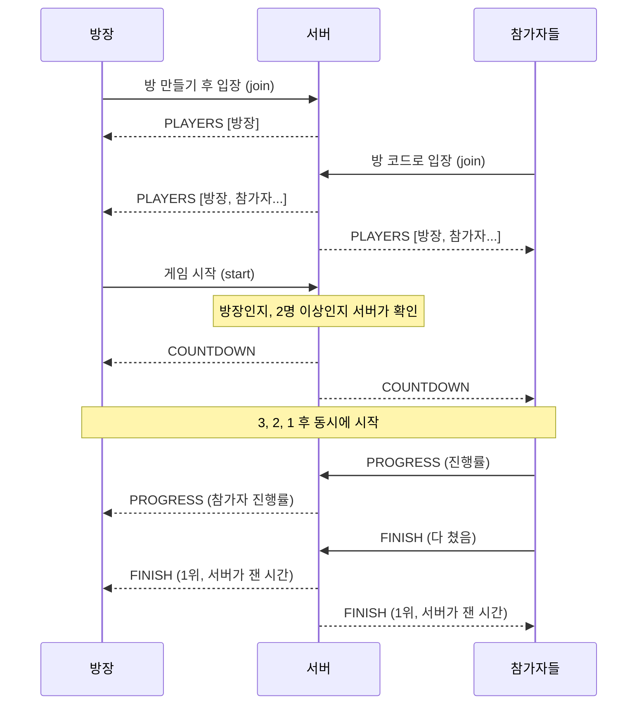
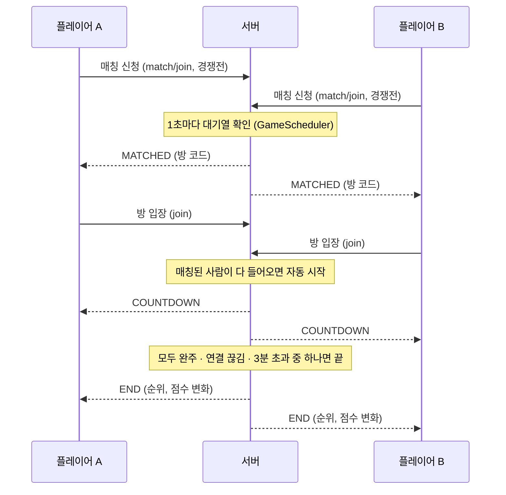

# ⌨️ 코드 타자 배틀

같은 코드를 **누가 먼저 정확하게 치는지** 최대 8명이 실시간으로 겨루는 웹 게임입니다.

**🔗 배포 주소: https://typingbattle-qsov.onrender.com**

> 무료 서버라 한동안 접속이 없으면 잠들어요. 첫 접속은 1~2분 정도 걸릴 수 있습니다.

<br>

## 📌 프로젝트 소개

- **개발 기간:** 2026년 11월
- **개발 인원:** 1명
- **만든 이유:** 코드를 빠르고 정확하게 치는 연습을 친구들과 게임처럼 하고 싶었습니다. 동시에 실시간 통신(WebSocket)과 Spring 서버 개발을 직접 경험해 보려고 만들었습니다.

<br>

## ✨ 주요 기능

### 실시간 대결 (최대 8명)
- **동시 시작:** 3초 카운트다운 후 모두 동시에 시작합니다. 시작 전에는 코드를 흐리게 가리고 입력도 막습니다.
- **실시간 진행률:** 참가자 모두의 진행률 막대가 실시간으로 움직입니다.
- **순위 판정:** 먼저 끝까지 정확하게 친 순서대로 1위부터 8위까지 순위가 매겨집니다. 결과 표에 순위, 걸린 시간, 타수, 정확도가 나옵니다.
- **제한 시간 3분:** 아무도 끝내지 못해도 3분이 지나면 게임이 끝나고, 못 끝낸 사람은 '미완주'로 표시됩니다.

### 랜덤 매칭
- 닉네임을 넣고 **[일반전]** 또는 **[경쟁전]**을 누르면 같은 모드를 기다리는 사람과 자동으로 묶입니다.
- 4명이 모이면 바로, 2~3명이면 5초 더 기다렸다가 매칭합니다. (한 방 최대 8명)
- 매칭된 사람이 모두 들어오면 방장 없이 **자동으로 시작**합니다. 10초가 지나도 안 온 사람은 빼고 시작하고, 20초 동안 2명이 안 모이면 매칭을 취소합니다.
- 같은 닉네임으로 동시에 매칭을 기다릴 수 없습니다.

### 일반전과 경쟁전, 랭킹
| 모드 | 들어가는 방법 | 점수 |
|---|---|---|
| 일반전 · 친구 방 | 방 만들기 → 방 코드 공유 | 변화 없음 |
| 일반전 · 랜덤 매칭 | 랜덤 매칭 [일반전] | 변화 없음 |
| 경쟁전 | 랜덤 매칭 [경쟁전] | 순위에 따라 오르내림 |

- **점수 계산:** 시작 점수 1000점, `점수 변화 = (참가 인원 + 1 − 2 × 순위) × 10`
  - 2명이면 1위 +10점, 2위 −10점
  - 4명이면 1위 +30점, 2위 +10점, 3위 −10점, 4위 −30점
  - 완주하지 못했거나 연결이 끊긴 사람은 꼴찌로 계산합니다.
- **티어:** 브론즈 · 실버(950점~) · 골드(1050점~) · 플래티넘(1150점~) · 다이아(1300점~)
- **랭킹 페이지:** 점수 순 TOP 20 (티어, 판수, 1위 횟수, 최고 타수). 로비에는 TOP 5가 나옵니다.
- 경쟁전 결과 화면에서 각자의 점수 변화(예: `+10점 (1010)`)를 보여 줍니다.

### 친구 방과 방장
- **방 만들기와 입장:** 방을 만들면 4자리 방 코드가 생기고, 친구들은 그 코드로 입장합니다.
- **방장이 시작:** 방을 만든 사람이 방장(👑)이 되고, 2명 이상 모이면 **[게임 시작]** 버튼으로 시작합니다.
- **방장 넘기기:** 방장은 다른 사람 옆의 **[방장 넘기기]** 버튼으로 방장을 넘길 수 있습니다. 방장이 나가면 다음 사람이 자동으로 방장이 됩니다.
- **입장 검사:** 없는 방, 같은 닉네임, 꽉 찬 방(9번째 사람), 이미 시작한 방, 랜덤 매칭 방은 입장을 막고 안내 메시지를 보여 줍니다.

### 연결 끊김 처리
- 브라우저를 닫거나 인터넷이 끊기면 서버가 바로 알아채고 방 전체에 알려 줍니다. (예: "철수님의 연결이 끊겼어요.")
- **시작 전:** 참가자 목록에서 빠지고, 방장이었다면 다음 사람이 방장이 됩니다.
- **게임 중:** 목록에 '연결 끊김'으로 남고, 결과에는 '탈주'로 기록됩니다. 남은 사람이 모두 끝내면 바로 게임이 끝납니다.
- 매칭을 기다리다 나가면 대기열에서 빠집니다. 방에 아무도 남지 않으면 방을 지웁니다.

### 난이도와 문제
- **난이도 선택:** 방을 만들 때와 혼자 연습할 때 쉬움, 보통, 어려움, 랜덤 중에서 고를 수 있습니다.
- **문제 98개:** 쉬움 33개, 보통 33개, 어려움 32개
- **7가지 언어:** Java, Spring, Python, JavaScript, SQL, HTML, CSS
- **어려움 문제 예시:** 이진 탐색, 퀵 정렬, BFS, DP, 스트림, 제네릭, 정규식, JPA 연관관계, async/await, SQL 서브쿼리와 윈도 함수

### 타자 판정
- 맞게 친 글자는 초록색, 오타는 빨간색으로 표시합니다.
- **오타가 나면 백스페이스로 고쳐야** 다음 글자로 넘어갈 수 있습니다.
- 줄 끝에서는 Enter를 쳐야 하고, 줄 앞 들여쓰기는 자동으로 건너뜁니다.
- 한글 입력 상태로 치면 "한/영 키를 눌러 주세요" 경고를 보여 줍니다.

### 화면
- 초록색 계열의 밝은 테마
- 휴대폰처럼 좁은 화면에서도 깨지지 않는 반응형 화면
- **혼자 연습하기 모드** (난이도 탭)

<br>

## 🛠 기술 스택

| 구분 | 기술 |
|---|---|
| Backend | Java 21, Spring Boot 4.1, Spring WebSocket (STOMP), Spring Data JPA |
| Database | H2 (메모리 DB) — 문제, 경쟁전 점수 |
| Frontend | HTML, CSS, JavaScript, Thymeleaf, stomp.js |
| 빌드 · 배포 | Gradle, Docker, Render |

<br>

## 🏗 구조

### 대결 진행 흐름



### 랜덤 매칭 흐름



### WebSocket 메시지

| 주소 | 방향 | 설명 |
|---|---|---|
| `/app/match/join` | 브라우저 → 서버 | 랜덤 매칭 신청 (닉네임, 모드) |
| `/app/rooms/{방코드}/join` | 브라우저 → 서버 | 방 입장 |
| `/app/rooms/{방코드}/start` | 브라우저 → 서버 | 게임 시작 (친구 방의 방장만 가능) |
| `/app/rooms/{방코드}/host` | 브라우저 → 서버 | 방장 넘기기 (방장만 가능) |
| `/app/rooms/{방코드}/progress` | 브라우저 → 서버 | 내 진행률 보내기 |
| `/app/rooms/{방코드}/finish` | 브라우저 → 서버 | 다 쳤다고 알리기 |
| `/topic/match/{티켓}` | 서버 → 나 | `MATCHED`, `DUPLICATE` |
| `/topic/match/waiting/{모드}` | 서버 → 대기 중인 사람 | `WAITING` (대기 인원) |
| `/topic/rooms/{방코드}` | 서버 → 방 전체 | `PLAYERS`, `COUNTDOWN`, `PROGRESS`, `FINISH`, `NOTICE`, `END`, `CANCELED` |

### 패키지 구조

```
src/main/java/com/example/typingbattle
├── config       WebSocketConfig         WebSocket(STOMP) 설정
├── controller   RoomController          로비, 방 만들기, 입장 (HTTP)
│                GameController          입장, 시작, 방장 넘기기, 진행률, 완료 (WebSocket)
│                MatchController         매칭 화면, 매칭 신청 (HTTP + WebSocket)
│                RankingController       랭킹 화면
│                PracticeController      혼자 연습하기
├── service      GameService             게임 진행, 연결 끊김, 게임 끝내기
│                MatchService            일반전·경쟁전 대기열과 매칭
│                RankingService          경쟁전 점수 계산과 랭킹 조회
│                RoomService             방 생성, 조회, 삭제
│                SnippetService          난이도별 문제 무작위 선택
├── task         GameScheduler           1초마다 매칭, 제한 시간, 빈 방 확인
├── event        DisconnectListener      연결 끊김(SessionDisconnectEvent) 처리
├── repository   SnippetRepository       문제 DB 조회 (JPA)
│                PlayerStatRepository    경쟁전 점수 조회 (JPA)
├── entity       Snippet                 문제 (DB 테이블)
│                PlayerStat              닉네임별 점수, 판수, 1위 횟수 (DB 테이블)
└── model        Room                    대결 방 (서버 메모리, 최대 8명)
                 MatchTicket             매칭 대기표
                 PlayerResult            한 사람의 게임 결과
                 GameMessage             WebSocket 메시지
```

<br>

## 💡 설계하면서 고민한 점

**1. 왜 WebSocket을 썼나요?**
누가 들어오거나 진행률이 바뀌면 서버가 **먼저** 알려 줘야 합니다. 일반 HTTP는 브라우저가 요청할 때만 응답할 수 있어서, 서버와 브라우저가 연결을 유지하며 서로 메시지를 보낼 수 있는 WebSocket을 썼습니다.

**2. 방 정보는 왜 DB가 아니라 메모리에 두었나요?**
방은 게임하는 몇 분 동안만 필요한 데이터라서 서버 메모리에 두었습니다. 여러 사람이 동시에 방을 만들고 입장하므로 `ConcurrentHashMap`을 사용했습니다. 문제(코드 조각)처럼 계속 남아야 하는 데이터는 DB에 저장했습니다.

**3. 순위와 시간은 누가 정하나요?**
**서버가 정합니다.** 브라우저의 시간은 사용자가 조작할 수 있기 때문에, 서버가 완료 메시지를 받은 순서대로 순위를 매기고 걸린 시간도 서버 시각으로 계산합니다.

**4. 방장만 시작할 수 있게 어떻게 막았나요?**
화면에서 방장이 아닌 사람에게 버튼을 숨기는 것만으로는 부족합니다. 개발자 도구로 시작 메시지를 직접 보낼 수 있기 때문입니다. 그래서 **서버의 `canStart()`에서 방장인지, 2명 이상인지 한 번 더 확인**하고, 조건이 맞지 않으면 시작 요청을 무시합니다.

**5. 난이도별 문제는 어떻게 가져오나요?**
Spring Data JPA의 **쿼리 메서드** `findByDifficulty(String difficulty)`를 썼습니다. 메서드 이름만 규칙대로 지으면 `WHERE difficulty = ?` 쿼리가 자동으로 만들어집니다. "랜덤"을 고르면 결과가 비어 있으니 전체 문제에서 고르도록 했습니다.

**6. 진행률을 너무 자주 보내지 않나요?**
진행률(%)이 **바뀔 때만** 서버에 보냅니다. 한 사람당 한 게임에 최대 100번 정도라 8명이 동시에 해도 서버 부담이 적습니다.

**7. 매칭은 언제 이루어지나요?**
`@Scheduled(fixedRate = 1000)`로 1초마다 대기열을 확인합니다. 4명이 모이면 바로 묶고, 2~3명이면 첫 사람이 5초 이상 기다렸을 때 묶습니다. 너무 오래 기다리지 않으면서도 가능하면 여러 명이 함께 하도록 정한 기준입니다.

**8. 연결이 끊긴 건 어떻게 아나요?**
브라우저와 서버의 WebSocket 연결이 끊기면 Spring이 `SessionDisconnectEvent`를 보내 줍니다. 입장할 때 `세션 ID → 방 코드, 닉네임`을 저장해 두었다가, 이 이벤트가 오면 누가 어느 방에서 나갔는지 찾아 처리합니다.

**9. 닉네임을 메시지에서 그대로 믿나요?**
아니요. 처음 입장할 때만 닉네임을 받고, 그 뒤의 시작, 방장 넘기기, 완료 메시지는 **세션 ID로 저장해 둔 닉네임**을 씁니다. 그래서 개발자 도구로 다른 사람 닉네임을 넣어 보내도 그 사람인 척할 수 없습니다. 완료 메시지도 글자 수에 비해 너무 빠르면(한 글자에 0.03초 미만) 무시합니다.

**10. 경쟁전 점수는 언제 바뀌나요?**
모두 완주했거나, 남은 사람이 모두 완주했거나(나머지는 연결 끊김), 3분이 지났을 때 서버가 게임을 한 번만 끝냅니다(`Room.end()`). 이때 순위대로 점수를 계산해 `PlayerStat`에 저장하고, 결과를 방 전체에 한 번에 보냅니다.

<br>

## 🔥 트러블슈팅

### 1. 두 사람이 동시에 입장하면 참가자 목록이 사라지는 문제

- **문제:** 두 사람이 거의 동시에 입장하면, 한 사람 화면에서 자기 진행률 줄이 사라지고 상대만 보였습니다.
- **원인:** 두 입장 요청이 서로 다른 스레드에서 동시에 처리되면서, 먼저 만든 **예전 목록 `[A]`가 새 목록 `[A, B]`보다 늦게 도착**해 화면을 덮어썼습니다.
- **해결:**
   - 입장 처리(목록에 추가 → 목록 보내기)를 `synchronized (room)`으로 묶어 한 명씩 차례로 처리했습니다.
   - `setPreservePublishOrder(true)`, `setPreserveReceiveOrder(true)`로 메시지가 보낸 순서대로 도착하게 했습니다.
- **배운 점:** 실시간 서비스에서는 기능이 맞아도 **메시지 도착 순서**가 바뀌면 화면이 틀어질 수 있다는 것을 알게 되었습니다.

### 2. 결과 화면에 순위가 `undefined`로 나오는 문제

- **문제:** 대결이 끝나면 결과 표에 순위와 시간이 `undefined`, `NaN`으로 나왔습니다.
- **원인:** `GameMessage`에 필드만 추가하고 **getter를 만들지 않았습니다.** Spring이 메시지를 JSON으로 바꿀 때 getter가 있는 값만 담기 때문에 순위와 시간이 빠졌습니다. 게다가 IntelliJ 자동 완성으로 만든 setter는 값을 저장하지 않는 빈 메서드였습니다.
- **해결:** 모든 필드의 getter와 setter를 제대로 만들었습니다.
- **배운 점:** 자바 객체가 JSON으로 바뀌는 원리(getter 기준)를 이해하게 되었습니다.

### 3. 방 입장에 실패하면 404 에러가 나는 문제

- **문제:** 처음 접속한 사람이 틀린 방 코드를 넣으면, 안내 메시지 대신 404 에러 페이지가 나왔습니다.
- **원인:** 에러 메시지를 잠깐 세션에 담아 전달했는데, 쿠키가 아직 없는 첫 접속에서는 서버가 세션 ID를 주소 뒤에 `;jsessionid=...`로 붙였습니다. Spring이 이 주소를 처리하지 못해 404가 났습니다.
- **해결:** `server.servlet.session.tracking-modes=cookie` 설정으로 세션을 쿠키로만 관리하게 했습니다.

### 4. Render 배포 실패

- **문제:** Render 빌드 로그에 `open Dockerfile: no such file or directory`가 나오며 배포가 실패했습니다.
- **원인:** `Dockerfile`을 프로젝트 맨 위가 아니라 `src` 안의 패키지 폴더에 만들었습니다.
- **해결:** `git mv`로 `Dockerfile`을 프로젝트 맨 위로 옮겼습니다. Windows에서 올린 `gradlew` 파일에 실행 권한이 없는 문제도 대비해 Dockerfile에 `chmod +x gradlew`를 넣었습니다.

### 5. `<=`가 `≤`로 보이는 문제 (글꼴 리거처)

- **문제:** 코드 글꼴을 JetBrains Mono로 바꾼 뒤 `<=`가 `≤`로, `==`가 `═`로, `++`가 한 글자처럼 합쳐져 보였습니다. 타자 게임에서는 쳐야 할 글자와 보이는 글자가 달라지면 안 됩니다.
- **원인:** 개발자용 글꼴의 **리거처(ligature)** 기능이 여러 글자를 하나의 기호로 합쳐서 보여 줬습니다.
- **해결:** 코드 영역에 `font-variant-ligatures: none;`을 넣어 글자 합치기를 껐습니다.
- **배운 점:** 디자인을 바꿀 때도 서비스의 핵심 기능(정확한 글자 표시)에 영향이 없는지 확인해야 한다는 것을 배웠습니다.

### 6. 문제 코드가 오른쪽으로 크게 밀리는 문제

- **문제:** 문제 코드의 둘째 줄부터 오른쪽으로 크게 밀려서 화면 밖으로 잘리거나 이상하게 줄바꿈되었습니다.
- **원인:** `data.sql`을 IntelliJ에 붙여 넣을 때 자동 정렬 기능이 줄을 `VALUES (` 위치에 맞추면서, **SQL 문자열 안에 공백이 60칸씩** 들어갔습니다. 문자열 안의 공백은 그대로 문제 내용이 되기 때문에 화면에도 그대로 나왔습니다.
- **해결:** 정규식 `^ {60}`(줄 맨 앞 공백 60칸)을 빈칸으로 바꿔서 한 번에 지웠습니다. 화면보다 긴 줄은 `white-space: pre-wrap;`으로 다음 줄로 넘어가게 했습니다.
- **배운 점:** 데이터 파일은 코드처럼 보여도 **공백 하나까지 데이터**라는 것을 알게 되었습니다.

<br>

## ▶️ 실행 방법

### 내 컴퓨터에서 실행

Java 21이 필요합니다.

```bash
./gradlew bootRun
```

브라우저에서 http://localhost:8080 에 접속합니다. 창을 여러 개 열면 혼자서도 대결을 시험해 볼 수 있습니다.

### Docker로 실행

```bash
docker build -t typingbattle .
docker run -p 8080:8080 typingbattle
```

<br>

## 🚀 앞으로 개선할 점

- [x] 경쟁전 점수를 DB에 저장하고 랭킹 페이지 만들기
- [x] 게임 중에 누군가 나가면 알려 주기 (연결 끊김 처리)
- [x] 방장이 나가면 다음 사람에게 방장 넘기기
- [x] 아무도 끝내지 못할 때를 위한 제한 시간
- [ ] 게임 중 새로고침해도 다시 들어올 수 있게 하기
- [ ] 웹 화면에서 문제를 등록, 수정, 삭제하는 관리자 페이지
- [ ] H2 대신 MySQL을 써서 서버가 재시작돼도 랭킹 유지 (지금은 서버가 다시 켜지면 랭킹이 초기화됩니다)
- [ ] 로그인 기능 (지금은 닉네임이 같으면 같은 사람의 점수로 기록됩니다)